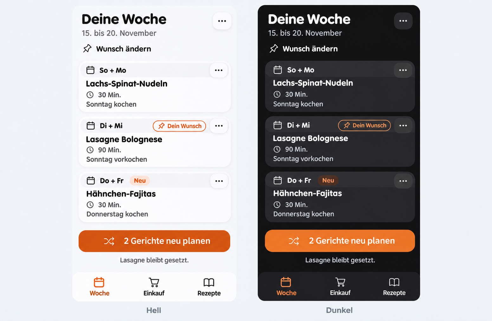
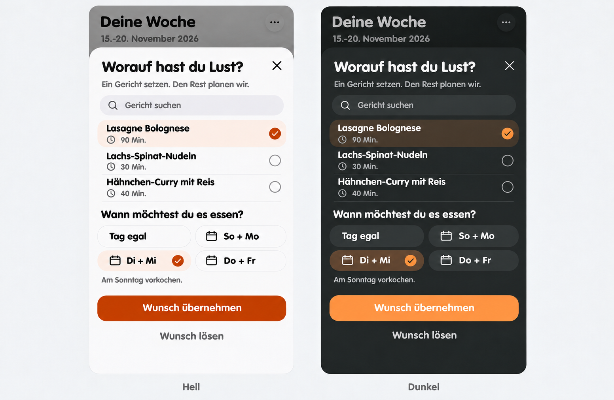
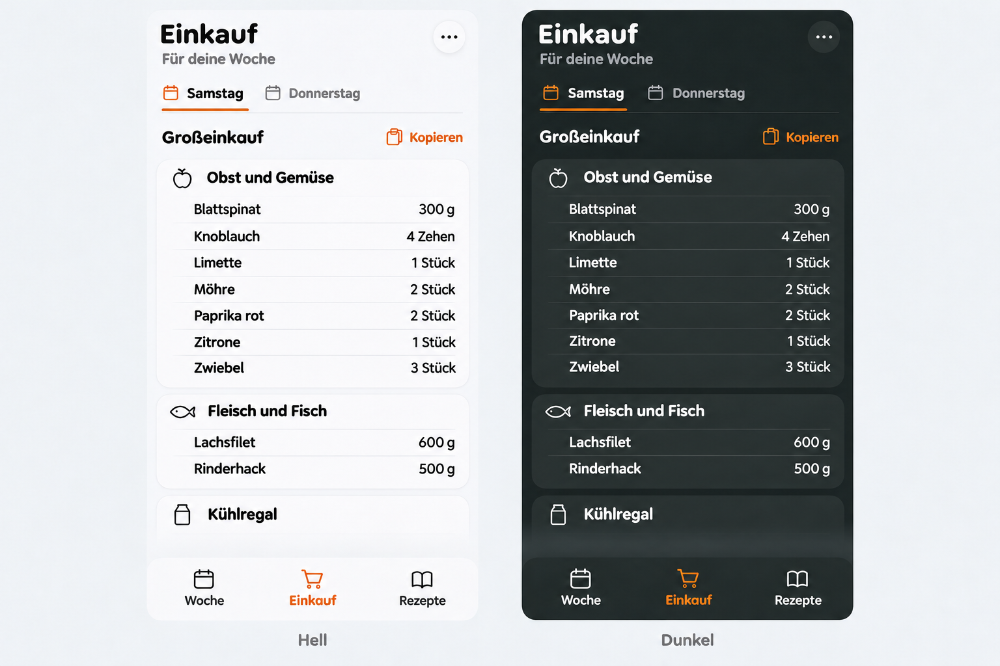
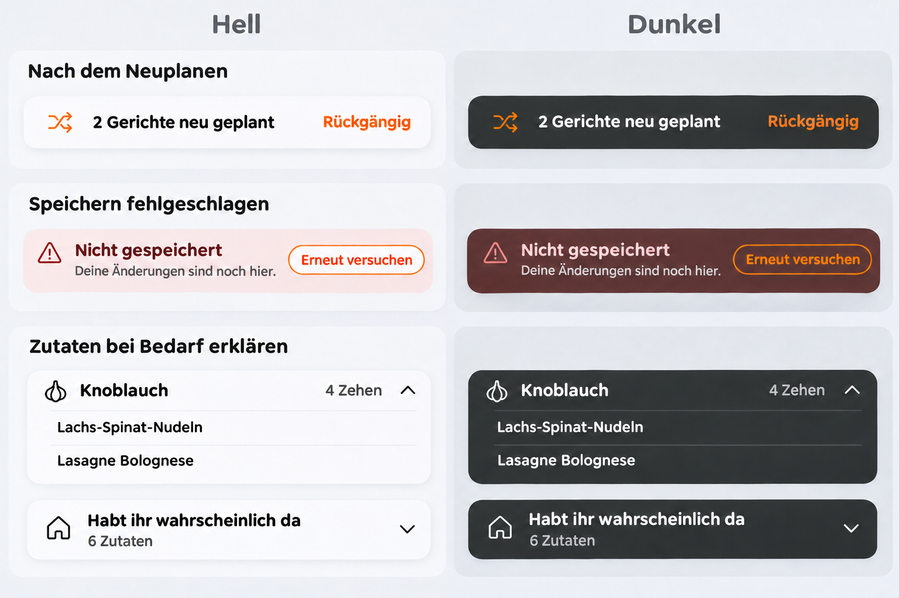

# Revised mobile mockups

Updated 15 November 2026 from the user's feedback and the inspected Mobbin references in the [UI concept](../ui-concept-2026-11-15.md). The user requested quieter screens, calendar icons, an optional weekly wish and the subsequent UX refinements.

These AI-generated images are design references, not screenshots of implemented functionality or device tests. Both themes apply to both phones. Text, spacing, fonts and colors must be implemented with system fonts and local tokens rather than sampled literally from the images. The behavior requirements below govern details that a bitmap cannot demonstrate.

## Current screens

| Asset | Changes |
| --- | --- |
| [Week](week.png) | Calendar headings; separate cooking lines; one overflow action per card; wish pin; “Wunsch ändern”; precise “2 Gerichte neu planen” action. |
| [Wish](wish.png) | Selected recipe and eating-day group; calendar choices; “Wunsch übernehmen”; explicit “Wunsch lösen”. |
| [Shopping](shopping.png) | Expanded ingredient categories; aligned quantities; recipe sources hidden until requested; scrollable continuation below the viewport. |
| [Feedback and details](states.png) | Undo after replanning; persistent save-error feedback with retry; ingredient source disclosure; collapsed pantry section. |

## Weekly planning and wishes

### Selected neutral palette

Use neutral white/light-gray surfaces in light mode and neutral near-black surfaces in dark mode, with a brighter orange accent. The week board shows the selected visual direction.

Wish, shopping and feedback boards illustrate the agreed UX in the original neutral styling. Their accent shades have not been redrawn to match the selected week board. For implementation, the token values below take precedence over colors sampled from those images.

Exact values are in [palette.json](palette.json): canvas #121214, cards #232326 and raised controls #2C2C30 in dark mode; primary fill #E66D20 in both themes; small dark-mode accents #FF9B5D. Keep light surfaces neutral white/gray. Avoid colored page washes and glowing buttons. Generated bitmaps are illustrative and can deviate from exact tokens.

Hallmark application: preserve layout and neutral surfaces at polish depth; use a restrained accent; separate large filled actions from small foreground accents; make dark cards lighter than the canvas; verify contrast per pairing. Neutral surfaces intentionally override Hallmark's anchor-tinted neutral recipe because the user explicitly rejected the visible color cast. This is a bitmap proposal, not a rendered application, so a CSS/render sweep cannot establish its implementation quality.

Calculated primary-label contrast is 3.05:1 (#F8FAFB on #E66D20), suitable only for large text. Use at least 20 CSS px at weight 700 for these labels; normal-sized text needs a darker foreground (5.56:1 with #181818). Small text actions use the separate accent-text tokens. Confirm actual rendered values and states before release; no complete accessibility pass is claimed.

### Planning behavior

- Keep three dishes, each for four portions: A is eaten Sunday/Monday and cooked Sunday; B is eaten Tuesday/Wednesday and prepared Sunday; C is eaten Thursday/Friday and cooked Thursday. Calendar icons represent eating days, while duration uses a clock and preparation stays on its own line.
- Existing automatic selection runs after a button press. Scheduled background generation is not implemented and is not implied by these mockups. A wish is optional; planning must work without opening a wish sheet.
- Start with at most one wish per week. Search the existing recipe catalog, choose a recipe and either “Tag egal” or an eating-day group. Unknown/free-text dishes need a separate recipe/link flow; do not pretend they have known ingredients or storage information.
- Before a wish exists, use “Wunschgericht”. Once set, use “Wunsch ändern” and show a pin plus “Dein Wunsch” on its assigned card. Both household members edit the same wish, not separate competing preferences.
- On an empty week, the sheet action reads “Woche damit planen” and generates the remaining dishes. On an existing week, “Wunsch übernehmen” applies the selected wish, preserves unaffected dishes when valid and closes only after a successful save. A changed wish can require regenerating other dishes to satisfy the plan; show those affected slots before applying that change.
- “Tag egal” selects a compatible slot when the wish is first applied. Once assigned, preserve that slot during “2 Gerichte neu planen”. Changing its day is an explicit action.
- “Wunsch lösen” removes only the constraint. Keep the dish and the rest of the current plan unchanged. The weekly action returns to “Woche neu planen”. Closing the sheet or pressing Back/Escape without applying changes leaves the saved wish unchanged.
- Preserve the wish during a reroll. The planner must search the remaining candidates while honoring the existing rule hierarchy, including storage compatibility, distinct recipes, previous-week exclusions, protein coverage and the new-recipe rule. A new wish counts toward the new-recipe quota. Do not silently relocate, drop or replace a wish to satisfy another rule.
- Disable incompatible automatic-placement choices with a concise reason. In particular, B needs three-day suitability; a wish treated as the new recipe must use the automatic planner's allowed A/C slots. Show the reason beside the affected choice. If no valid plan exists even after the defined relaxations, keep the existing plan and ask the user to change the wish or day.
- Replacing/rerolling a pinned dish goes through the wish flow. Manual moves remain an explicit exception governed by the existing manual-move proposal; move the wish identity with the dish and make any rule warnings visible.

## Undo and shared state

- After a successful replan, show “2 Gerichte neu geplant” with “Rückgängig” in a non-blocking status region above the bottom navigation. Never show successful-save feedback while the write has failed or is still pending.
- Offer a single-step undo until the next plan mutation. If the transient message dismisses, keep the same undo action in the week menu until it expires through a mutation. Do not rely on a short timeout as the only way to recover a plan.
- Undo restores the prior plan, wish and affected planning provenance as one consistent change. It must not roll back unrelated favorites, links, recipe feedback or the partner's changes.
- Bind undo to the revision produced by the original change. If a remote update changes that revision, invalidate undo rather than overwrite the newer plan. Explain “Der Plan wurde inzwischen geändert.” This needs real concurrency tests before release.
- Preserve search text, selected draft values, scroll and focus when remote updates arrive. Reconcile against the latest shared state before applying a draft; do not save stale whole-document snapshots over partner edits.
- Keep normal saved state quiet. Pending saves can show a small “Wird gespeichert…” status. A failed save shows persistent “Nicht gespeichert”, “Deine Änderungen sind noch hier.” and “Erneut versuchen”. Retain the draft for retry; do not imply persistence across reloads unless implemented.
- Write success and live-listener health are separate states. A successful retry must not clear a terminal subscription error. Show “Aktualisierung unterbrochen” separately when shared updates are unavailable, with a reconnect/reload recovery path that preserves unsaved input first.

## Shopping

- Keep Saturday and Thursday as calendar-labelled tabs. “Kopieren” copies the selected day's list, not whichever list was previously open. A successful copy is acknowledged; failure offers a usable text fallback.
- All actual ingredient groups start expanded. Only “Habt ihr wahrscheinlich da” starts collapsed. Pantry membership is based on the ingredient's pantry flag, not the category named “Vorrat”; items such as pasta still belong in the main list.
- Show ingredient and amount on one row. Tapping the row reveals its contributing recipe names. Use a disclosure control with an accessible expanded state and a clear focus state. No calendar icon belongs before a recipe name.
- Preserve per-dish Bring actions below the ingredients. Do not introduce a second shared checklist state in these mockups.
- The shopping image is the top of a scrolling list. Dairy, bread, dry goods, pantry and Bring continue below; they are not omitted from the actual design. Reserve bottom padding for the navigation.
- Example quantities were checked through the existing `einkaufsliste` function using A `lachs-spinat-nudeln`, B `lasagne` and C `haehnchen-fajitas`. Saturday includes 300 g spinach, 4 garlic cloves, 1 lime, 2 carrots, 2 red peppers, 1 lemon, 3 onions, 600 g salmon and 500 g beef mince. The six pantry entries also come from that calculation. These are example data, not a live household snapshot.

## Device and accessibility requirements

- Target the iPhone 15 Pro at a 393 CSS px portrait layout. The partner's exact older Galaxy A model is unknown: validate 360 and 412 CSS px widths, without claiming these are that device's measured dimensions. Both light and dark must work on both devices.
- Every interactive target is at least 48 by 48 CSS px, independently of a small 16–18 px icon. The screenshots are not measurements; allow additional scrolling rather than shrinking rows to fit their illustrated composition.
- Support 200% text scaling, long recipe names, visible focus, screen-reader names and reduced motion. Selected choices use a checkmark and accessible state as well as color. Calendar icons next to text are decorative and hidden from assistive technology.
- Use safe-area padding and a scrollable sheet body. Keep close and apply controls reachable with the software keyboard open. Do not lock the page behind a keyboard-obscured button.
- Android Back closes the top sheet before navigating away from the page. Escape and the close button do the same without committing. Restore focus to the trigger. Contain modal focus and avoid trapping focus in hidden background content.
- Verify all of this in the implemented browser UI, then check touch, keyboard, sheet dismissal and scrolling on the actual phones. No physical-device pass is claimed here.

## Delivery scope

This changes only the mockup PNGs and design documentation. Runtime code, SPEC and production behavior are unchanged. Existing review commits already cover their own small fixes. Wish storage, planner constraints, undo, conflict handling, modal behavior and the responsive UI still require implementation and tests before release.

Validation on 15 November 2026: visually inspected all four boards, checked the shopping example against the current calculation, and confirmed that the PNG files open. Existing regression suite: 99 tests passed. Full recipe validation: 37 recipes passed. These checks do not validate unimplemented interactions, exact CSS dimensions or accessibility contrast in the illustrative bitmaps.
